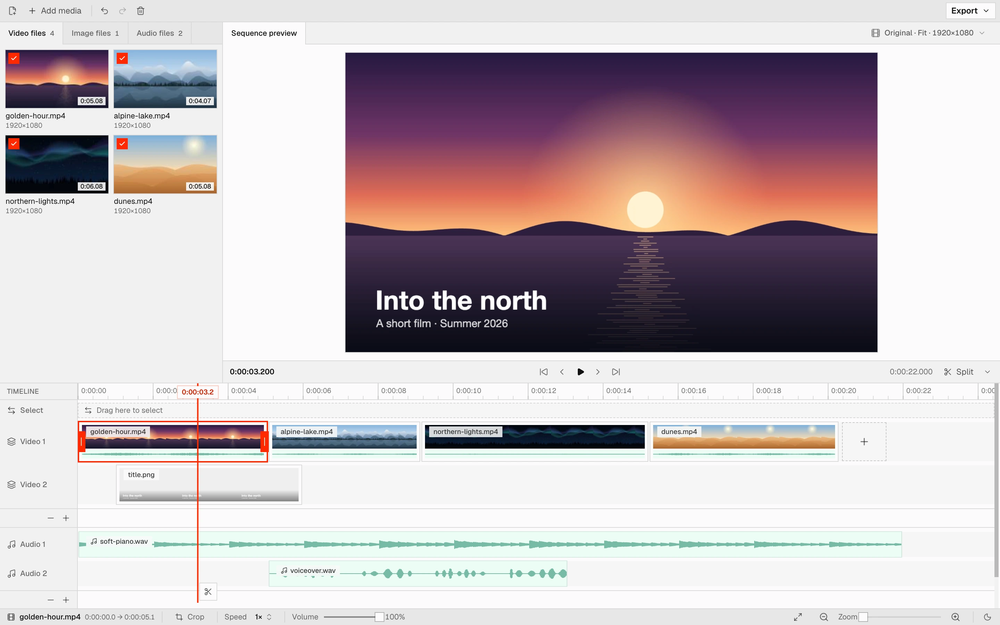
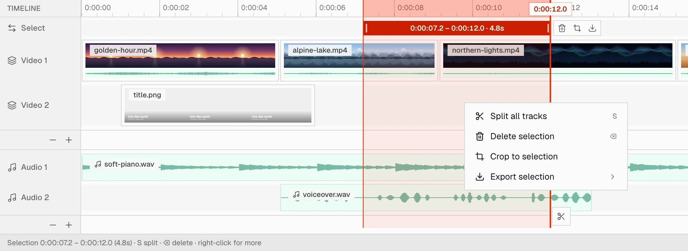
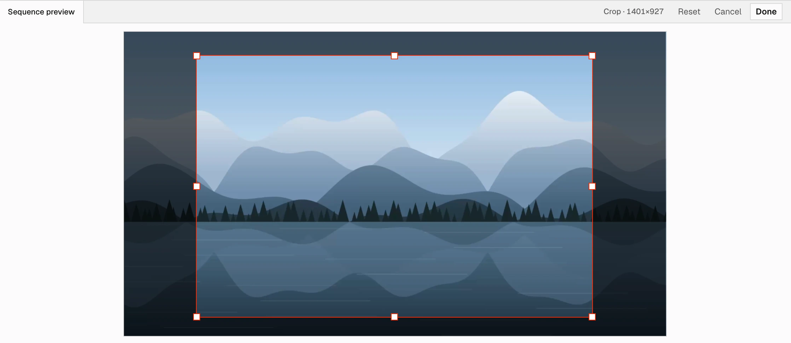
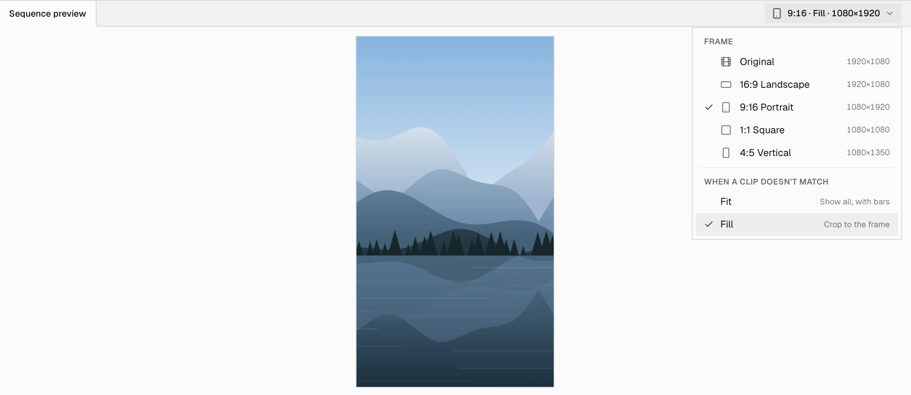
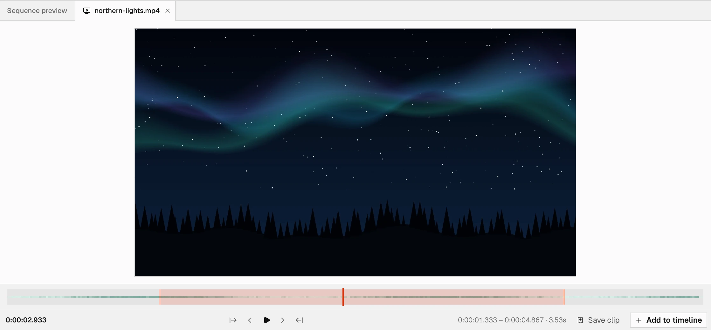

<p align="center">
  
</p>

<h1 align="center">Video Editor</h1>

<p align="center">
  <b>Edit video in your browser. Your files never leave your device.</b><br>
  Cut, arrange, crop, add music and a title, then export an MP4. That's the whole idea.
</p>

<picture>
  <source media="(prefers-color-scheme: dark)" srcset="docs/screenshots/editor-dark.webp">
  
</picture>

## Only what you need

Most videos come together with the same few moves: trim the clips, put them in order, lay music under them, maybe add a title, and export. This editor is built around those moves and leaves out everything else, so there's nothing to learn before you start and nothing in the way once you do.

- **Drop your files in and start.** They land on the timeline in the order you dropped them. No account, no upload: files are read straight from your disk, and a 5 GB video costs a few MB of memory.
- **Tools show up when they can do something.** Select a clip and its crop, speed and volume appear in one row. Select a stretch of time and you can split it, delete it, crop to it or export it. Nothing sits greyed out, waiting.
- **A timeline that keeps itself tidy.** The main track keeps clips back to back, so a cut never leaves a hole you didn't ask for. Edges snap to other clips, to the playhead and to round times.
- **Keys you already know.** Space plays, S splits, I and O mark a range, the arrows step frames, ⌘Z undoes.
- **It saves as you go.** Close the tab, come back tomorrow, and the project is where you left it.
- **What you see is what you export.** The preview and the export draw every frame with the same code. Plain cuts aren't re-encoded at all: they're copied as they are, at disk speed, with nothing lost.

## A quick tour

### Cut across every track

<picture>
  <source media="(prefers-color-scheme: dark)" srcset="docs/screenshots/cut-dark.webp">
  
</picture>

Drag in the **Select** bar to mark a stretch of time on every track at once. Split it, delete it and let the gap close, keep only that part, or export just that part. Right-click it for the same choices.

### Crop to what matters

<picture>
  <source media="(prefers-color-scheme: dark)" srcset="docs/screenshots/crop-dark.webp">
  
</picture>

Select a clip and press **Crop**. Drag a corner or an edge to cut that side (hold **⇧ Shift** to cut the opposite side as much), or drag the middle to move the box. Press Enter and the part you kept fills the frame.

### Wide, tall or square

<picture>
  <source media="(prefers-color-scheme: dark)" srcset="docs/screenshots/frame-dark.webp">
  
</picture>

One menu sets the shape of the video: the clips' own, 16:9, 9:16, 1:1 or 4:5. Clips that don't match either fit inside with bars or fill the frame.

### Pick the good part first

<picture>
  <source media="(prefers-color-scheme: dark)" srcset="docs/screenshots/clip-dark.webp">
  
</picture>

Double-click a file in the bin to watch it on its own. Mark In and Out, then add just that part to the timeline or save it as a clip in the bin. A long recording turns into the pieces you need.

## What's in it

- **Editing**: trim, split, merge split pieces back, ripple delete, gaps on the main track, speed from 0.25× to 4× with the pitch kept, volume, unlinking a clip's sound, undo and redo.
- **Layers**: overlay tracks for videos and pictures (transparency kept), pictures moved and resized right on the preview, and as many audio tracks as you need.
- **Media**: video, audio and images (JPEG, PNG, WebP, GIF, AVIF, BMP). Files the browser can't play, like an AVI or ProRes, are converted once, on your device. Waveforms are ready within seconds, even for a 4-hour file.
- **Export**: MP4 at the original size, 1080p or 720p, at 24, 25, 30 or 60 fps, for the whole edit or just a selection. Long exports stream straight to disk.
- **Comfort**: light and dark themes, resizable panels, tracks you can rename, and a saved project that finds its files again after a reload.

## Shortcuts

| Key                   | Action                                                       |
| --------------------- | ------------------------------------------------------------ |
| Space                 | Play / pause                                                 |
| S or ⌘/Ctrl+B         | Split all tracks at the playhead (or at the selection edges) |
| Delete / Backspace    | Delete the selected range (ripple) or the selected clips     |
| ⇧-click, ⌘/Ctrl-click | Add a clip to the selection, or take it out                  |
| ⌘/Ctrl+J              | Merge the selected pieces of a split clip                    |
| I / O                 | Mark range start / end at the playhead                       |
| ← / →                 | Previous / next frame (with Shift: 1 second)                 |
| Home / End            | Go to start / end                                            |
| ⌘/Ctrl+Z, ⇧⌘/Ctrl+Z   | Undo, redo                                                   |
| Enter                 | Keep a crop                                                  |
| Esc                   | Clear the selection, or cancel a crop                        |

## Get started

```bash
pnpm install
pnpm dev        # http://localhost:5173
```

Open the address, drop in a few files and edit. Chromium browsers get the most out of it: a saved project finds its files again after a reload (at most one click), and exports stream straight to disk.

## How it works

Every feature in detail, for when you want to know exactly what happens.

<details>
<summary><b>The media bin, pictures and crop</b></summary>

Import video, audio and images (drag-drop/picker) into a tabbed media bin. Images go on video tracks like a video without sound: they come in 5 seconds long and stretch to any length, on Video 1 or as overlays (transparency kept). Drag a picture on the preview to move it, or a corner of its box to resize it; its edges and centre snap to the frame's, with a guide line (⌥ places freely). Select a video or picture clip and press **Crop** in the footer to keep part of its picture: the preview shows it whole, drag the box's corners or edges to cut those sides (with **⇧ Shift**, the opposite sides by as much, so the box keeps its centre) or its middle to move it, then **Done** (Enter) or **Cancel** (Esc). What's left is fitted to the frame like a whole clip, and an Original frame takes the first clip's cropped size. Each file's checkbox shows whether it's on the timeline: uncheck it to set its clips aside (cuts, trims, speed and places included), check it again to put them back as they were, or to add a file that was never on it. Right-click a file to remove it (its clips leave the timeline too, after a confirmation; undo brings them back). Also: magnetic video track (slide clips to leave gaps, or move them by drag), audio track (free placement), trim handles, per-clip speed 0.25–4× (pitch preserved), volume, aspect presets 16:9 / 9:16 / 1:1 / 4:5 with fit or fill, 24–60 fps, MP4 export at Original, 1080p or 720p (H.264/AAC, falls back to other codecs the browser can encode). Resizable timeline and media bin, undo/redo.

</details>

<details>
<summary><b>Selecting and cutting</b></summary>

drag in the **Select** bar under the ruler (or on any empty lane) to select a time range across all tracks (live Selection Start/End beside the moving edge, the playhead follows it). The range shows in the bar as a block with its times and length: drag its edges to resize it or its middle to move it. Click or drag the ruler to move the playhead (hover shows the time; a selection stays); a click offers two small buttons at the playhead to mark the selection start or end there. Tools right after the block delete, crop or export it, and right-clicking inside it opens Split all tracks / Delete selection / Crop to selection / Export selection. Zooming pivots on the playhead: it stays put on screen, or comes to the middle if it was out of view. Editing never changes the zoom, so the view holds still while you trim, move or delete. Delete closes the gap on every track (ripple delete); Crop keeps only the selection and zooms to fit; Export writes just that part, at the edit's frame size.

</details>

<details>
<summary><b>Tracks</b></summary>

Video 1 is the magnetic main track: clips follow each other, plus any gap you leave. Drag a Video 1 clip sideways to slide it and everything after it (the gap opens in front of it; an Offset readout shows its new start); drag it left until its middle passes the clip in front and it's carried alone, dropping in where you let go (at that time if there's room, pushing later clips only if they'd overlap). Gaps play and export as black. Every video clip shows its own sound as a waveform strip under its thumbnails, so the sound moves, trims, splits and deletes with it. Right-click a clip → **Unlink audio** to move that sound into its own clip on the first free audio lane (the video clip goes silent); from then on they edit separately. The **− +** row under each group removes or adds a track: Video 2, 3, … are overlay tracks drawn on top of the ones below (in Fit mode their bars show the layer underneath), and Audio 1, 2, … hold music, voiceover and unlinked sound. Drag media from the bin onto any lane, drag clips up or down to change lanes (between Video 1 and the overlay tracks too: leaving Video 1 closes up the clip's length, entering it slots the clip in). **−** removes the last added track and asks first (alert dialog) if it still has clips; Video 1 and Audio 1 always stay. Click a track's name to rename it (Enter keeps it, Esc cancels, an empty name brings the default back). Waveforms are read once per file right after import, in Web Workers (long files as parallel slices, one per spare core: a 4-hour video takes ~5 s); until done the strip shimmers, the bars fill in and a thin bar fills along the bottom of the file's thumbnail in the bin.

</details>

<details>
<summary><b>Snapping</b></summary>

while you move or trim a clip, select a range or drop from the bin, edges within 8 px lock onto other clips' starts and ends (on every track), the playhead and 0:00, and a guide line shows the exact time. With nothing to snap to, edits land on the ruler's small ticks, so times come out round at any zoom (tenths zoomed in, whole minutes far out), and timeline times show only the digits those ticks need. Hold **⌥ Alt** while dragging to place freely, down to single frames when zoomed in.

</details>

<details>
<summary><b>Files the browser can't decode</b></summary>

Files the browser can't decode (an AVI, an old codec in an MKV, ProRes, or HEVC where there's no decoder) are converted once, on this device, into an MP4 the browser plays (H.264 video, AAC sound), then come in like any other file, under their own name. The software decoder (WebAssembly, about 30 MB, part of the app) loads only when such a file comes along. When only the sound is the problem (say, AC-3 in an MKV), the video is copied as it is, which takes moments; re-encoding video runs around ten times faster than real time for 720p. A toast shows the progress, and closing it cancels. The copy is kept in the browser's private storage, so a saved project finds it after a reload; copies no project uses are cleared on the next load.

</details>

<details>
<summary><b>Lossless export</b></summary>

when the video only needs copying, it's copied as it is, packet for packet: no decoding, no re-encoding, no quality lost, and it takes about as long as reading the files. That's when the edit is Video 1 only (no overlays, no speed changes, no crops, no gaps, and the video lasts as long as the sound), its files share one encoding, at the export's size and frame rate (Original or 1080p), and every piece starts on a key frame of its file (most cameras put one every second or two; a file's start always is one). Pieces can end anywhere, or only at the file's end for files with B-frames. So joining camera files, putting music under untouched video, or trimming the ends of clips all export losslessly; the sound is still mixed and encoded as usual. Anything else is rendered, and the finished message says which happened.

</details>

<details>
<summary><b>Clip Preview</b></summary>

double-click a file in the bin (or right-click → Open in Clip Preview) to play it on its own, in a tab next to the sequence. Mark the part you want with In/Out (**I** / **O**, the buttons, or by dragging the marks on the bar; the waveform shows there too), then **Add to timeline** (video goes to the end of Video 1, audio at the playhead) or **Save clip** to keep that part as a new clip in the bin, so one long file splits into the pieces you need. Saved clips go on the timeline as just their part (and can still be trimmed out to the whole file), and open in Clip Preview with their marks. Space plays and stops at the Out point (press it there to play the part again); ← / → step frames, Home / End jump to In / Out.

</details>

<details>
<summary><b>Saving</b></summary>

the project saves itself as you edit (IndexedDB, on this device), along with each file's thumbnail and waveform; the video and audio stay where they are on disk. Reload or reopen the tab and it's back. Files added with **Add media** or dropped in Chromium browsers keep a handle to the file on disk: if the browser still allows reading them the project comes back by itself, otherwise one click on **Reconnect files** asks once. Files without a handle (other browsers, or moved on disk) are picked or dropped again and matched by name and size. **Start fresh** drops the saved project, and **New project** (the first button in the header) clears the current one; files on disk are never touched.

</details>

<details>
<summary><b>Splitting</b></summary>

the scissors at the playhead's foot, or the Split ▾ button under the preview (split selected clip / all tracks / Video 1 / overlay tracks / audio tracks). With a range selected, splits happen at both of its edges.

</details>

## Why it's fast

| Choice                                                                                   | Why                                                                                                                             |
| ---------------------------------------------------------------------------------------- | ------------------------------------------------------------------------------------------------------------------------------- |
| **WebCodecs** for decoding and encoding                                                  | Runs on the hardware video engine, with no download and no memory cap                                                           |
| Lazy reads from the file on disk                                                         | A 5 GB file costs a few MB of RAM                                                                                               |
| `<video>` elements drawn to a `<canvas>` for preview                                     | Native hardware playback; the next clip is pre-parked at its in-point for instant cuts                                          |
| Playback loop outside React                                                              | Playhead and clock are written straight to the DOM: zero re-renders while playing                                               |
| Shared `drawFrame()`                                                                     | What you see in the preview is exactly what you export                                                                          |
| Decode straight to output size                                                           | 4K sources stay cheap when exporting 1080p                                                                                      |
| Lossless copy when nothing needs re-encoding                                             | Plain cuts of files that share one encoding export at disk speed, bit for bit                                                   |
| Frames that need no drawing go to the encoder as decoded                                 | Exports below 720p run about 3× faster (the encoder reading a canvas back costs ~3 ms a frame), and keep the file's full detail |
| Export runs in a Web Worker (video decode, draw, encode, mux, file writes)               | The editor stays responsive while exporting; only the audio mix, which needs Web Audio, stays on the page                       |
| Audio mixed (`OfflineAudioContext`) in 30-second chunks, in step with the video encoding | Export time ≈ video encode time, and memory stays flat however long the edit is                                                 |
| Stream to disk (`showSaveFilePicker`, Chrome/Edge)                                       | Long exports don't fill RAM; cancel discards the partial file                                                                   |
| Timeline renders only what's near the view                                               | Zooming into a multi-hour clip costs the same as a short one                                                                    |
| Waveforms read in Web Workers, in parallel slices                                        | A 4-hour file's waveform is ready in seconds without blocking the UI                                                            |

## Development

```bash
pnpm test       # timeline model self-check
pnpm fuzz       # random edit sequences against the timeline model (pnpm fuzz 10000 80 for a longer run)
pnpm build
```

Browser smoke test (generates clips, edits, exports, verifies the MP4): with the dev server open, run `await (await import('/test/e2e.js')).run()` in the devtools console. For stress tests, `test/make-media.sh` fills the git-ignored `test/media/` with odd, broken and long files (a 2-hour one, 60 small clips); `test/e2e.js` has helpers to load them into the editor.


### Files

```
src/
  main.tsx                 entry: mounts the app with its tooltip and toast providers
  app/App.tsx              the editor's layout, wired to the hooks below
  components/
    ui/                    building blocks: Select, Slider, Tip, Toasts, ConfirmDialog, Divider, class recipes
    header/                the header row (New project, Add media, undo/redo/delete, Export)
    bin/                   the media bin and its file cards
    preview/               preview tabs, the sequence view and restore panel, transport, Clip Preview, frame menu
    timeline/              the timeline: ruler, Select bar, tracks, clips, waveforms, playhead, menus, footer
    export/                the export menu's choices and the progress dialog
  hooks/                   the editor's state and behaviour: project and history, zoom, player, saving,
                           importing and converting, Clip Preview, export, shortcuts
  lib/
    model/                 the timeline model: types, layout, edits, tracks, snapping, times, output frame.
                           Pure (no DOM), so it runs and is checked in Node
    media/                 probing files, waveforms (in workers), converting files the browser can't decode
    export/                MP4 export: the page side (audio mix) and the worker (video, muxing, file writing)
    player.ts              the preview engine (media elements, a canvas and a clock)
    store.ts               saving the project in IndexedDB and reconnecting its files
    utils.ts               cn() for class names, and small shared helpers
  styles/globals.css       theme tokens (ink, muted, accent, panel greys) and base styles
  assets/fonts/            the variable UI font
test/                      model checks, the model fuzzer, browser helpers, the stress-media script
public/                    favicon and app icons
docs/screenshots/          the screenshots in this README, light and dark
```

Imports use `@/` for `src/` (`@/lib/model`, `@/components/ui`); `lib/model` imports its own files relatively, with `.ts`
extensions, so Node can run it directly. Class names are joined with `cn()`, which also settles conflicting utility classes (the
last class wins).

## Roadmap

Next:

1. **Text overlays**: add a layer to `drawFrame()`; preview and export get it for free.
